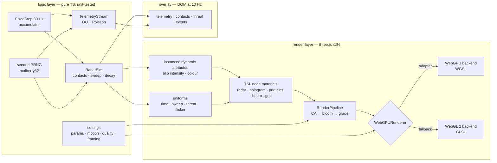

# webgpu-hud

[](https://github.com/HOFFMAN-ALTERNATIVE/webgpu-hud/actions/workflows/ci.yml)
[](https://hoffman-alternative.github.io/webgpu-hud/)
[](LICENSE)

A real-time tactical HUD on three.js r186 `WebGPURenderer`. Every effect is a TSL node
material, so one shader codebase compiles to WGSL on WebGPU and to GLSL on the WebGL 2
fallback. CI proves the fallback path on every push: Playwright boots the built site on
SwiftShader and decodes canvas pixels before GitHub Pages is allowed to deploy.

**[Live demo](https://hoffman-alternative.github.io/webgpu-hud/)**

[](https://hoffman-alternative.github.io/webgpu-hud/)

<sub>Captured in headless Chromium on the WebGL 2 fallback (software rasteriser). Try
`?renderer=webgl`, `?quality=low|medium|high`, `?seed=anything`, `?motion=reduced`.</sub>

## What is in the scene

- Radar: one procedural TSL fragment (rings, ticks, sweep with exponential phosphor
  trail) plus instanced contact blips with altitude stalks fed by per-instance attributes.
- Hologram core: fresnel shell with travelling scanlines, wireframe lattice, orbit rings.
- Particles: 6k, 16k or 32k instanced sprites depending on quality tier, animated
  entirely in the vertex stage, so the CPU does no per-frame particle work.
- Light cone and floor grid: layered additive geometry instead of raymarching.
- Post stack: scene pass, radial chromatic aberration scaled by threat level, bloom,
  vignette, scanlines, grain.
- Telemetry panels: 7 Ornstein-Uhlenbeck channels at 30 Hz with Poisson incidents
  (λ = 0.12/s), rendered as DOM at 10 Hz.

## How it works



Each frame: `dt` feeds a fixed-step 30 Hz simulation (frozen when paused or the tab is
hidden), springs drive camera parallax, uniforms and instance attributes are updated,
`pipeline.render()` draws, and the DOM overlay refreshes every 100 ms.

## Run it

```bash
npm ci
npm run dev          # http://localhost:5173
npm run check        # lint, typecheck, unit tests, production build
npm run e2e          # Playwright against `vite preview`
```

| URL parameter | Values | Effect |
|---|---|---|
| `renderer` | `auto` (default), `webgpu`, `webgl` | backend selection |
| `quality` | `auto`, `low`, `medium`, `high` | particle count, bloom, DPR cap |
| `seed` | any string | deterministic telemetry and radar |
| `motion` | `auto`, `full`, `reduced` | override `prefers-reduced-motion` |

`window.__HUD__` exposes `{ ready, backend, frames, tier, motion, error }` for automation.

## Numbers

Measured 2026-10-17 on the current `main`:

| | |
|---|---|
| Unit tests | 28 (Vitest), 100 % lines, 99.2 % branches of the logic layer |
| Browser tests | 7 (Playwright, Chromium on SwiftShader), about 2 minutes locally |
| Bundle | app 11.8 kB gzip, three.js chunk 243.7 kB gzip |
| `npm audit` | 0 vulnerabilities |

I have not published frame-rate numbers. They depend on the GPU and browser, and the CI
runner only has a software rasteriser.

## Design decisions

- [ADR 0001](docs/adr/0001-tsl-node-materials.md): TSL node materials instead of
  hand-written WGSL and GLSL. One graph per material serves both backends; the cost is
  a younger API and the 244 kB three.js chunk.
- [ADR 0002](docs/adr/0002-analytic-particles.md): particle motion is a pure function
  of seed and time in the vertex shader, not a compute pass. Identical on both backends,
  zero CPU and upload cost; particles cannot interact.
- [ADR 0003](docs/adr/0003-dom-overlay-for-text.md): text panels are HTML/CSS over the
  canvas. Sharp at any DPR, selectable, readable by screen readers.
- The simulation runs at a fixed 30 Hz with a capped accumulator, so a backgrounded tab
  does not fast-forward. Visual-only motion uses frame-rate-independent damping.
- Everything is seeded. Screenshots and tests are reproducible, and a bug report can say
  `seed=xyz`.
- Quality tiers come from backend, core count, viewport and DPR, never from the user agent.

## Limits

- The light cone is faked with additive shells. It does not react to scene geometry.
- No real data source. The telemetry and radar are simulations; wiring a WebSocket feed
  would replace `TelemetryStream` and `RadarSim` behind the same interface.
- WebGPU itself is not exercised in CI, only the WebGL 2 fallback. The WebGPU path is
  tested manually in Chrome.
- Source maps are published with the demo on purpose; strip them for a closed product.

## Accessibility and security

`prefers-reduced-motion` (or the `M` key) removes flicker, grain and camera drift;
`Space` pauses; toggles carry `aria-pressed`. The production build ships a strict
Content-Security-Policy (no inline scripts, no third-party origins), and the e2e suite
fails on any CSP violation. See [SECURITY.md](SECURITY.md).

## Tests

| Suite | What it covers |
|---|---|
| `test/core.test.ts` | PRNG determinism, ring buffer, `damp` identical at 60 and 144 fps, spring never overshoots, fixed-step cap, formatters |
| `test/sim.test.ts` | telemetry bounded and mean-reverting, Poisson rate within ±20 %, sweep crossing the 360°/0° seam, every contact pinged once per revolution |
| `test/settings.test.ts` | URL parsing, reduced-motion precedence, quality tiers, portrait framing |
| `e2e/hud.spec.ts` | boots with no page errors or CSP violations, decodes canvas screenshots (lit pixels, cyan and magenta content), frames advance, pause freezes the clock, reduced motion, phone layout |

CI runs `check` (lint, typecheck, coverage, build), then `e2e` on the built artefact,
then deploys that same artefact to Pages.

## Project layout

```
src/core      prng, ring buffer, animation math, formatters, settings (pure)
src/sim       telemetry stream, radar simulation (pure)
src/render    renderer bootstrap, uniforms, radar, fx, post
src/ui        DOM overlay, sparklines
test/         Vitest unit tests
e2e/          Playwright browser tests
scripts/      screenshot.mjs (regenerates docs/preview.png)
```

## License

[MIT](LICENSE) © 2026 Herman Hoffman
