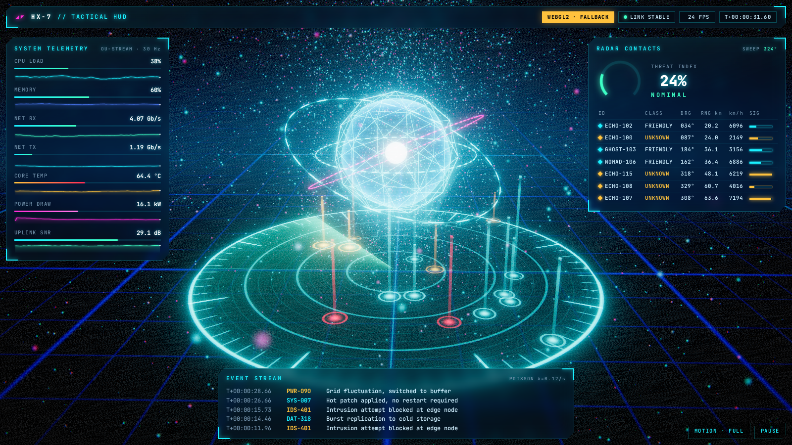
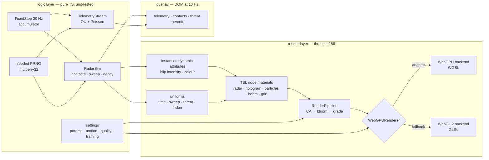

# webgpu-hud

[](https://github.com/HOFFMAN-ALTERNATIVE/webgpu-hud/actions/workflows/ci.yml)
[](https://hoffman-alternative.github.io/webgpu-hud/)


[](LICENSE)

A **volumetric cyberpunk tactical HUD** rendered with three.js
**`WebGPURenderer`** and **TSL node materials** — one shader codebase that
compiles to WGSL on WebGPU and to GLSL on the automatic **WebGL 2 fallback**.
A holographic radar with phosphor-decay contacts, a fresnel hologram core, a
GPU-animated particle field, a fake-volumetric light cone, a mip-chain bloom
post stack, and crisp telemetry panels driven by a seeded, simulated data stream.

### ▶ [Live demo](https://hoffman-alternative.github.io/webgpu-hud/)

[](https://hoffman-alternative.github.io/webgpu-hud/)

<sub>Screenshot taken in headless Chromium on the **WebGL 2 fallback** (software
rasteriser) — on a WebGPU browser it renders the same scene through WGSL.
Try `?renderer=webgl`, `?quality=low|medium|high`, `?seed=anything`, `?motion=reduced`.</sub>

## Why

Most "HUD" demos are flat SVG wireframes or a single fullscreen shader. This
one is built like a production real-time UI:

- **WebGPU-first, never WebGPU-only.** The renderer asks for a WebGPU adapter and
  silently falls back to WebGL 2 (headless CI, older Safari / Firefox, blocklisted
  GPUs). Every effect is TSL, so nothing is written twice.
- **Depth, not decoration.** Additive shells, fresnel falloff, altitude stalks,
  depth-faded grid and near-camera bokeh particles read as volume when the camera
  drifts — then bloom and radial chromatic aberration sell the light.
- **Data-driven.** Panels are not animated by timers: telemetry comes from
  Ornstein–Uhlenbeck processes with Poisson incidents, the radar from a contact
  simulation with real sweep geometry. Same seed → same picture.
- **Respectful.** `prefers-reduced-motion` (or the in-app toggle) calms the
  scene, removes flicker/grain/camera drift and disables CSS animation; hidden
  tabs pause the simulation; quality scales to the device.

## Features

| | |
|---|---|
| Renderer | `WebGPURenderer` with automatic WebGL 2 backend · `?renderer=webgpu\|webgl\|auto` · ACES tone mapping · DPR capped per tier |
| Radar | Single procedural TSL fragment: rings, ticks, crosshair, rim, sweep with exponential phosphor trail, beam-lit grid lines · instanced blips + camera-facing altitude stalks fed by per-instance dynamic attributes |
| Hologram | Fresnel shell with travelling scanlines and band sweeps, vertex "breathing", wireframe lattice, pulsing core, three dashed orbit rings |
| Particles | 6k–32k instanced sprites animated entirely in the vertex stage (swirl, rise, twinkle) — no per-frame CPU work |
| Volumetrics | Layered additive light cone with streaks and rising bands · distance-faded floor grid with a radial pulse |
| Post | `RenderPipeline`: scene pass → radial chromatic aberration (stronger with threat) → `BloomNode` → vignette, scanlines, film grain, threat tint |
| Telemetry | 7 OU channels at 30 Hz with Poisson incidents (λ = 0.12/s), ring-buffer history, sparklines, threat gauge on a critically damped spring, event stream |
| Responsive | Desktop three-panel layout → stacked phone layout; camera framing + view offset keep the radar clear of the panels |
| Accessibility | Reduced-motion profile, keyboard (`Space` pause, `M` motion), `aria-pressed` toggles, semantic panels, fixed-width numerals (no jitter) |
| Quality | strict TypeScript · ESLint · 28 Vitest tests, 100 % line coverage of the logic layer · 7 Playwright tests decoding real canvas pixels · Pages deploy gated on both |

## Architecture



Frame loop: `dt` → fixed-step simulation (scaled by the motion profile, frozen
when paused or hidden) → springs for camera parallax → uniforms + instance
attributes → `pipeline.render()` → overlay refresh every 100 ms.

## Quickstart

```bash
npm ci
npm run dev          # http://localhost:5173
npm run check        # lint + typecheck + unit tests + production build
npm run e2e          # Playwright smoke test against `vite preview`
```

| URL parameter | Values | Effect |
|---|---|---|
| `renderer` | `auto` (default), `webgpu`, `webgl` | backend selection (`webgl` forces the fallback) |
| `quality` | `auto`, `low`, `medium`, `high` | particle count, bloom, DPR cap |
| `seed` | any string | deterministic telemetry + radar picture |
| `motion` | `auto`, `full`, `reduced` | override `prefers-reduced-motion` |

`window.__HUD__` exposes `{ ready, backend, frames, tier, motion, error }` for
automation.

## Design decisions & trade-offs

- **TSL over hand-written WGSL/GLSL.** One node graph per material targets both
  backends and composes in TypeScript (helpers like an anti-aliased `line()`),
  at the cost of a younger API and larger bundle (~245 kB gzip for three).
  It is what makes the fallback free.
- **Analytic particle motion instead of compute shaders.** Positions are a pure
  function of `(seed, time)` in the vertex stage. Compute + storage buffers would
  allow interactions, but WebGL 2 can only emulate them; analytic motion is
  identical on both backends and costs zero CPU and zero bandwidth.
- **Fake volumetrics.** Layered additive shells + bloom give 90 % of a raymarched
  light cone at a fraction of the fill-rate — important on the WebGL fallback and
  integrated GPUs.
- **DOM for text, GPU for light.** Panels are HTML/CSS (`backdrop-filter`, clip-path
  chamfers): perfectly sharp text at any DPR, selectable, accessible, cheap to
  restyle. They update at 10 Hz — text changing at 60 Hz is unreadable anyway.
- **Fixed-step simulation.** The sim runs at 30 Hz regardless of frame rate, with a
  capped accumulator so a backgrounded tab doesn't fast-forward; visual-only
  motion uses frame-rate-independent `damp` and closed-form springs.
- **Seeded everything.** Reproducible screenshots, deterministic tests, and bug
  reports that say "seed=xyz" instead of "it looked weird once".
- **Quality tiers from capabilities, not user agents.** Backend, cores, viewport
  and DPR choose particles / bloom / pixel ratio; WebGL 2 at 4K drops to `low`.

## Tests

```bash
npm test              # Vitest: 28 tests
npm run coverage      # thresholds: lines 90 %, functions 90 %, branches 85 %
npm run e2e           # Playwright (Chromium, WebGL 2 on SwiftShader)
```

| Suite | What it proves |
|---|---|
| `test/core.test.ts` | PRNG determinism + distribution, Box–Muller variance, ring buffer, `damp` is frame-rate independent (60 vs 144 fps), spring never overshoots for any `dt`, fixed-step cap, fixed-width formatters |
| `test/sim.test.ts` | telemetry reproducible per seed, bounded, mean-reverting, Poisson rate within ±20 %; compass bearings, sweep crossing across the 360°→0° seam, **every contact pinged exactly once per revolution**, exponential decay, respawn, threat monotonicity, sparkline geometry + drawing |
| `test/settings.test.ts` | URL parsing and validation, reduced-motion precedence, quality tiers, monotonic portrait framing |
| `e2e/hud.spec.ts` | boots with no page errors and reports the backend; **decodes canvas screenshots** (lit-pixel ratio, cyan + magenta content, centre brighter than corners); forced WebGL; frames advance and pixels change; panels populated by the stream and the clock ticks; pause freezes time; reduced motion honoured + toggles; phone layout keeps panels below the radar |

CI (`.github/workflows/ci.yml`): `check` (lint, typecheck, coverage, build) →
`e2e` (Playwright on the built artefact) → `pages` (deploy the same artefact).
The demo is only published when both pass.

## Project layout

```
src/core      prng · ring buffer · animation math · formatters · settings (pure)
src/sim       telemetry stream · radar simulation (pure)
src/render    renderer bootstrap · uniforms · radar · fx (hologram, beam, grid, particles) · post
src/ui        DOM overlay · sparklines
test/         Vitest unit tests
e2e/          Playwright smoke tests
scripts/      screenshot.mjs (regenerates docs/preview.png)
```

## License

[MIT](LICENSE) © 2026 Herman Hoffman
